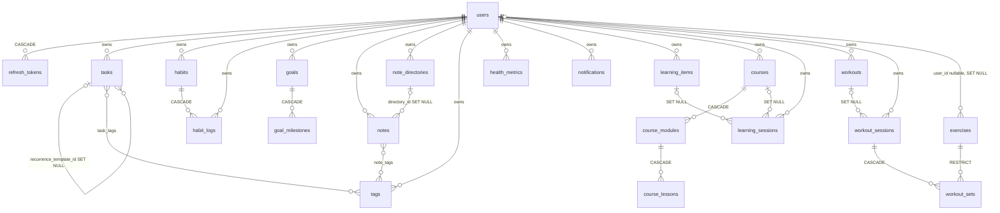

# Data Architecture

Last reviewed: 2026-10-10

PostgreSQL, SQLAlchemy 2 async, Alembic. Models: `backend/app/models/`; migrations: `backend/migrations/versions/`.

## ERD

Join tables `task_tags`, `note_tags` are in `models/tag.py` (composite PK, both FKs CASCADE).

## Conventions (`models/mixins.py`)

- `UUIDPkMixin`, `TimestampMixin` (`created_at`/`updated_at`, timezone-aware), `SoftDeleteMixin` (`deleted_at`), `OwnedMixin` (`user_id` FK `users.id` ON DELETE CASCADE, indexed).
- Soft delete: **tasks and notes only**. `BaseRepository._base_query` hides soft-deleted rows; `delete_owned` sets `deleted_at` when the model has it, else hard-deletes.
- Children without `user_id` (goal_milestones, course_modules/lessons, workout_sets) are owned through their parent.

## Constraints and indexes (verified in models)

| Table | Notes |
|---|---|
| users | unique functional index `uq_users_email_lower` on `lower(email)`; `timezone` default UTC |
| refresh_tokens | unique `token_hash`; `family_id` indexed; `revoked_at`, `expires_at`; `user_agent`, `ip_address` |
| habit_logs | unique `uq_habit_logs_habit_date (habit_id, log_date)` (target of ON CONFLICT upsert) |
| tags / note_directories | unique `(user_id, name)` |
| tasks | GIN `ix_tasks_search_vector`; `ix_tasks_user_status_due_date`; `recurrence_rule` JSONB |
| notes | GIN `ix_notes_search_vector`; `ix_notes_user_id_directory_id` |
| goals, learning_items | CHECK `progress_percent BETWEEN 0 AND 100` |
| health_metrics | CHECK `value >= 0`; `Numeric(10,2)`; index `(user_id, metric_type, recorded_at)` |
| workout_sets | CHECK `reps > 0`, `weight >= 0` |
| notifications | index `(user_id, is_read)` |
| learning_sessions | index `(user_id, session_date)` |

The GIN tsvector indexes exist but current search uses ILIKE (see [search](../features/search.md)).

## Migrations

Chain (file names): `2d27dbcfe619` initial -> `fe6451055195` pgcrypto -> `53096170c4b1` FK/composite indexes -> `9f4a2c1e7b3d` server-default fix -> `c4a8d2e61b90` note directories (head per AGENTS.md; chain order taken from the audit/AGENTS.md, not re-derived from `down_revision`). Docker CMD runs `alembic upgrade head` on boot. `tests/integration/test_migrations.py` covers upgrade/downgrade. `life_test` can lag the dev DB; migrate both.

## Transactions

One session and one transaction per request, committed in `get_session`. Services `flush()`; savepoints (`begin_nested`) wrap inserts that may hit unique constraints. Habit-log upsert is a single `INSERT ... ON CONFLICT DO UPDATE` (`habit_repository.py::upsert_log`). Refresh rotation uses a conditional `UPDATE ... WHERE revoked_at IS NULL RETURNING`.

## Pool

`pool_size`/`max_overflow` from `DATABASE_POOL_SIZE`/`DATABASE_MAX_OVERFLOW`; `pool_pre_ping=True`, `pool_recycle=1800`, `pool_timeout=30` (`db/session.py`). `lifespan` disposes the engine on shutdown.

## Update 2026-10-10: repository naming and documentation conventions

- Every public repository method ends with `_query` (e.g. `get_owned_query`, `list_for_user_query`, `email_exists_query`; 67 methods renamed across 13 repository modules, all call sites in services/api/tests updated). Private helpers (`_base_query`, `_order_by_clause`, `_ids`) keep their names - they are internal template methods, and `_base_query_query` would be meaningless.
- Every public repository method carries a one-line natural-language docstring.
- Every service-layer method/function carries a Google-style docstring (summary, Args, Returns, Raises) documenting only exceptions that actually propagate (`NotFoundError`/`ConflictError`/`UnauthorizedError`/`ValidationError` where raised, `SQLAlchemyError (logged, then re-raised)` where a branch exists, `ServiceError` where the wrap branch exists).
- Logging convention: entry INFO only for state-changing operations and complex aggregations; list successes log counts; reads stay quiet (debug for non-obvious decisions); `logger.exception` in every SQLAlchemyError branch; bare re-raise guards carry no log lines; secrets, tokens, emails and search query text are never logged.
