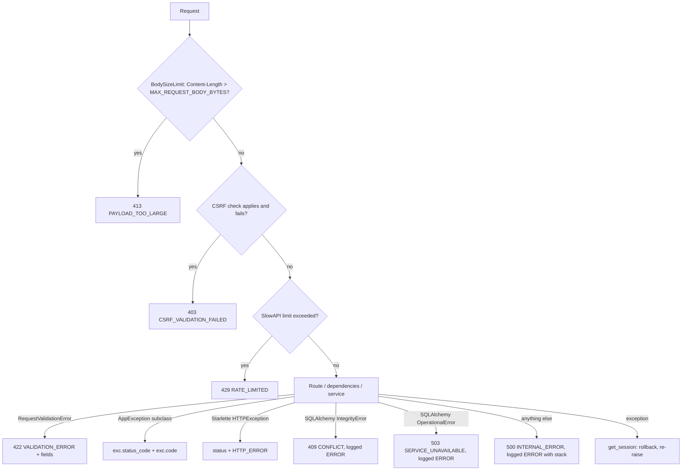

# Error Handling

Last reviewed: 2026-10-10

## Envelope

Every error: `{"error": {"code": "...", "message": "...", "fields": {"path": "msg"}?}}`. Stack traces are never returned. Built in `backend/app/core/exceptions.py::_error_body`; middleware (CSRF, body size) and the rate-limit handler (`main.py::_rate_limit_handler`) build the same shape inline.

## Lifecycle

Session rollback happens in `db/session.py::get_session` before the handler returns.

## Status / code table (from `core/exceptions.py` and other raisers)

| Status | Code | Source |
|---|---|---|
| 400 | `APP_ERROR` | base `AppException` default |
| 401 | `UNAUTHORIZED` | `UnauthorizedError` |
| 403 | `FORBIDDEN` | `ForbiddenError` (defined; no service raise found in grep) |
| 403 | `CSRF_VALIDATION_FAILED` | `CSRFMiddleware` |
| 404 | `NOT_FOUND` | `NotFoundError` (also for other users' resources) |
| 409 | `CONFLICT` | `ConflictError`, and global `IntegrityError` handler |
| 413 | `PAYLOAD_TOO_LARGE` | `BodySizeLimitMiddleware` |
| 422 | `VALIDATION_ERROR` | `ValidationError` and `RequestValidationError` (with `fields`) |
| 429 | `RATE_LIMITED` | `main.py::_rate_limit_handler` |
| 500 | `INTERNAL_ERROR` | catch-all |
| 502 | `STORAGE_UPLOAD_FAILED` | `storage_service.StorageUploadError` |
| 503 | `SERVICE_UNAVAILABLE` | `OperationalError` handler |
| 503 | `DATABASE_UNAVAILABLE` | `/health/db` probe failure (`api/liveness.py`) |
| 503 | `STORAGE_NOT_CONFIGURED` | `storage_service.StorageNotConfiguredError` |
| varies | `HTTP_ERROR` | Starlette `HTTPException` (e.g. unknown route 404, 405) |

`RateLimitedError` mentioned in the audit as dead code: not present in current `exceptions.py`.

## Policy (current)

- Services raise `AppException` subclasses; routes have no try/except.
- Unique-constraint races are translated to `ConflictError` inside savepoints (`begin_nested`) for register, tags, note directories; the global `IntegrityError` handler is a safety net.
- Pagination bounds are enforced via `Query(ge/le)` in `api/deps.py::get_pagination`, so `page_size=0` returns 422 (BE-004 fixed).
- Only the catch-all logs a stack at ERROR for unexpected failures; `AppException` responses are not logged by the handler.
- Known gap: `StarletteHTTPException` is flattened to `HTTP_ERROR`; clients cannot distinguish 404 route vs 405 by code.
- Client disconnect, DB statement timeouts beyond pool timeout: not specially handled (unverified beyond `OperationalError`).

## Update 2026-10-10: exception hierarchy and envelope

Source: `backend/app/core/exceptions.py`. Reviewed against code after this change.

| Class | HTTP | Code |
|---|---|---|
| `NotFoundError` | 404 | NOT_FOUND |
| `UnauthorizedError` | 401 | UNAUTHORIZED |
| `ForbiddenError` | 403 | FORBIDDEN |
| `ConflictError` | 409 | CONFLICT |
| `ValidationError` | 422 | VALIDATION_ERROR |
| `BusinessRuleError` | 422 | BUSINESS_RULE_VIOLATION |
| `ExternalServiceError` | 502 | EXTERNAL_SERVICE_ERROR |
| `ExternalServiceUnavailableError` | 503 | EXTERNAL_SERVICE_UNAVAILABLE |
| `ExternalServiceTimeoutError` | 504 | EXTERNAL_SERVICE_TIMEOUT |
| `InternalServerError` | 500 | INTERNAL_ERROR |

Storage errors subclass the external-service classes (`StorageNotConfiguredError` 503, `StorageUploadError` 502).

Envelope: `{"error": {"code", "message", "fields"?, "request_id"?}}`. `request_id` is additive and present when known.
Logging: 5xx errors (including `AppException` with status >= 500) are logged once, with stack trace, in the central handlers; 4xx are not logged there. Handlers log exception type names, not raw messages.
Rate limiting (429) and CSRF/413 responses are produced in `main.py`/middleware with the same envelope but without `request_id`.

## Update 2026-10-10: defense layers (route and service discipline)

Adapted from an external reference pattern, with two deliberate deviations: route/service catch blocks never put raw exception text in client responses (generic 500 message only), and services do not call `rollback()` (the per-request session in `db/session.py` owns commit/rollback).

Layers, in order:
1. Auth: `api/deps.py::get_current_user` raises `UnauthorizedError` -> 401.
2. Pydantic/FastAPI validation -> 422 (`RequestValidationError` handler).
3. Route layer (all handlers in `api/v1/routes/*.py`): `try` body; `except (AppException, SQLAlchemyError): raise` (preserves 404/409/503 mapping by the central handlers); `except Exception` -> `HTTPException(500, "An unexpected error occurred")` -> envelope `HTTP_ERROR`.
4. Service layer (public I/O methods in `services/*.py`): `except AppException: raise`; `except SQLAlchemyError`: log + re-raise; `except Exception`: log + `raise ServiceError(...) from exc`. Existing specific handlers (`IntegrityError` -> `ConflictError` inside `begin_nested` savepoints) take precedence.
5. Global handlers (`core/exceptions.py`): `ServiceError` -> 500 `INTERNAL_ERROR` (generic message, logged once with stack trace); `AppException` 5xx logged once; `IntegrityError` -> 409; `OperationalError` -> 503; catch-all -> 500.

Known trade-offs: a DB error is logged twice (service context, then the central `OperationalError` handler); `ServiceError` raised inside a route is converted by the route's broad catch to `HTTP_ERROR` (the dedicated `ServiceError` handler covers escapes outside routes, e.g. dependencies). Covered by `tests/api/test_service_error.py`.

## Update 2026-10-10: hierarchy restructure (pure parent)

`AppException` is now a pure parent that is never raised directly (enforced by a static test walking `app/` for `raise AppException(`). The hierarchy mirrors the reference `errors/error.py` design:

- `ServiceError` is back inside the family: `AppException` subclass, 500 `INTERNAL_ERROR`, default message `"Unexpected service error"`. The dedicated handler was removed - the `AppException` handler logs 5xx once and returns the generic message. Note: a `ServiceError`'s own message IS rendered to the client (all call sites use generic `"Unexpected error while ..."` text; a test locks this in).
- `NotFoundError(AppException, ValueError)`: dual constructor - legacy `NotFoundError("Habit not found")` or `NotFoundError(resource="Habit", id=x)` which auto-builds `"Habit not found with id: <x>"`. Existing call sites keep explicit messages.
- `InvalidPayloadError(AppException, ValueError)`: 422 with `fields={"invalid_fields": "a,b"}`.
- `DuplicateRecordError(ConflictError)`: 409 with structured `fields` (`resource`/`resource_id`/`resource_name`) and a reference-compatible `to_dict()`.

Route wrappers unchanged: `except (AppException, SQLAlchemyError): raise` now also passes `ServiceError` through to the central handler.

## Update 2026-10-10: guards tightened to specific exceptions

Per-method rule: a pass-through guard exists only where the try body can actually raise a domain error, and it names the specific subclasses (e.g. `except NotFoundError: raise`, `except (StorageNotConfiguredError, StorageUploadError, ValidationError): raise`), never the `AppException` parent. Across `app/services`: 35 dead guards deleted (pure list/read methods), 45 tightened to exact tuples derived by tracing direct raises, private helpers, cross-service calls and storage errors (repositories raise nothing). Routes keep `except (AppException, SQLAlchemyError): raise` - both members are reachable in every handler (services raise several domain types; every route touches the DB), and enumerating them per-route would risk turning a 4xx into a 500 when a new raise type is added.
