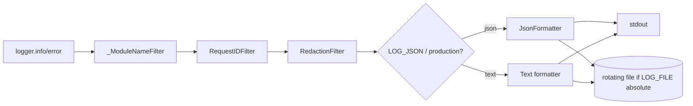

# Logging and Observability

Last reviewed: 2026-10-10

Code: `backend/app/core/logging.py`, `core/middleware.py` (RequestID), `core/config.py`, `main.py`.

## Destination policy (current)

- **stdout always** (`StreamHandler(sys.stdout)`), so Docker/Render collect logs.
- **File only if `LOG_FILE` is set to an absolute path.** A relative `LOG_FILE` is silently ignored (no file, no warning). Rotation: `RotatingFileHandler`, 5 MB x 5 backups.
- `*.log` and `logs/` are in root `.gitignore` and `backend/.dockerignore` (verified by grep).
- See [ADR-001](../decisions/ADR-001-logging-destination.md).

## Configuration

| Var | Default | Effect |
|---|---|---|
| `LOG_LEVEL` | `INFO` | root logger level |
| `LOG_FILE` | unset | absolute path enables rotating file handler |
| `LOG_JSON` | unset | unset => JSON iff `ENVIRONMENT=production`; true/false overrides |

`configure_logging(settings)` is called from `create_app()`; it is idempotent (removes and closes prior root handlers) and clears uvicorn/uvicorn.access/uvicorn.error handlers so they propagate to root (no duplicate lines).

## Formats

- Text: `asctime | LEVEL | request_id | module:func:line - message`.
- JSON (`JsonFormatter`): `timestamp` (UTC ISO), `level`, `logger`, `message`, `request_id`, optional `exc_info`.
- Logger names for app code are rewritten to module paths (`app.services.auth_service`) by `_ModuleNameFilter`.
- The stdlib is used; the old docs' "Structlog" claim was wrong.

## Request IDs

`RequestIDMiddleware` accepts an inbound `X-Request-ID` only if it fully matches `[A-Za-z0-9-]{8,64}`; otherwise generates a UUID4. It sets `request.state.request_id`, a `request_id_ctx` ContextVar (default `-`), and echoes the header on the response. A `RequestIDFilter` copies the ContextVar into each record. CORS allows the `X-Request-ID` request header.

Caveat: the ContextVar is reset when `call_next` returns, so log lines emitted by exception handlers after the middleware unwinds may show `-` (unverified; the 500 handler also embeds `request.state.request_id` in its message explicitly).

## Redaction

`RedactionFilter` (on every handler) masks, in message and exception text: DSN passwords (`postgres[ql][+driver]://user:***@`) and `key=value`/`key: value` pairs where the key contains `password|passwd|token|secret|authorization|cookie`. It renders `record.getMessage()` then drops args. Limits: regex-based; free-text secrets without a keyword are not caught. Request bodies are not logged by the app.

## Flow

## What is logged (examples)

`app_startup | environment=...`, `user_registered`, `user_logged_in | user_id=...`, `refresh_token_reuse_detected | user_id=...` (WARNING), `password_changed`, `avatar_upload_failed`, `avatar_cleanup_failed` (WARNING), `integrity_error`, `database_unavailable`, `unhandled_exception | request_id=...`, `liveness_db_check_failed | error_type=...`. User IDs (UUIDs) are logged; emails and passwords are not.

## Observability gaps

No metrics, tracing, or access-log request IDs beyond text/JSON fields; no alerting. No test files for redaction, request-ID validation, or log destination were found in `backend/tests` (BE-023 still open; test run not performed).

## Update 2026-10-10: level convention and message patterns

Level convention now applied across services/infra: `debug` flow traces and branch explanations; `info` milestones and successes with counts/ids; `warning` expected failures (not found, duplicate, auth reject, storage unconfigured); `logger.exception` inside `except` for DB errors (full traceback); `error` unexpected failures. Global handlers log 5xx once with stack trace; 4xx are not logged there.

Message-style rules: name the resource and id (`"Habit not found with id: ..."`); announce/success pairs for external I/O (S3 avatar upload/delete) with an actionable `Check: ...` hint on failure; list successes log the count; search query text is never logged (may contain personal content); emails, passwords and tokens are never logged (`RedactionFilter` masks secret-shaped key/value pairs and DSN passwords as a backstop). Startup logs one info milestone per phase plus a router count; shutdown logs engine disposal.

## Update 2026-10-10: catch-point logging rule

Every `except` branch in the service layer logs at the exact catch point: domain guards (`NotFoundError`/`ConflictError`/`UnauthorizedError`/`ValidationError`/storage errors) log one `ERROR` line naming the failed operation with ids (no traceback - the error is application-raised); `SQLAlchemyError` branches use `logger.exception`; unexpected failures log `ERROR` then wrap in `ServiceError`. Miss-detection points keep their `WARNING` line, so a not-found flow logs warning-at-detection plus error-at-catch. All logger calls use f-strings. Entry `INFO` remains only on state-changing operations and complex aggregations; list methods log one completion line with the count; single reads are silent. Verified by AST audit: no `except` branch in `app/services` is without a logger call.

## Update 2026-10-10: uniform entry/flow logging scheme

Every public service method logs entry as its first executable statement (`logger.info(f"Starting <operation> | <ids>")`; placed as the first statement inside the method's `try`). Repository and cross-service calls are traced with `DEBUG` lines from the service layer only - repositories contain no loggers by design. Completion: single reads log a `DEBUG` completion; list methods log `Successfully retrieved N ...`; writes keep their success `INFO`. Important I/O helpers log entry/outcome at `DEBUG`; trivial pure utilities (`is_due_today`, `is_completed`, `is_configured`, `progress_rules` formulas, `to_thread` delegates) are exempt. Every `except` branch logs at its catch point (domain guards: `ERROR` without traceback; `SQLAlchemyError`: `logger.exception`; unexpected: `ERROR` + `ServiceError` wrap). AST-audited: all public methods covered except the documented trivial exemptions; no secrets, tokens, emails, or search query text are logged; all logger calls use f-strings.
