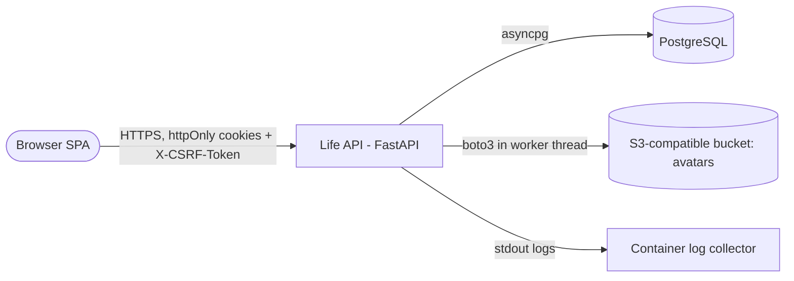
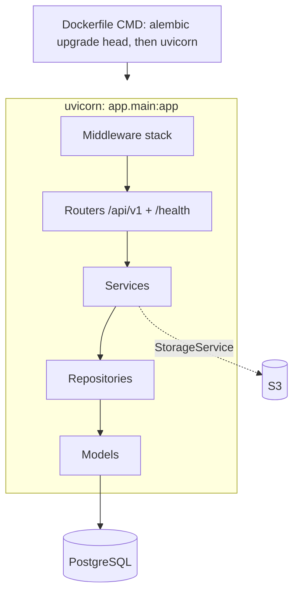
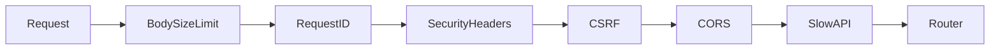
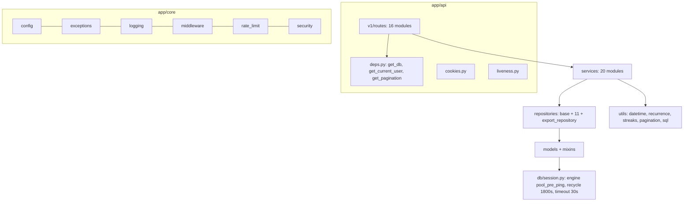

# System Overview

Last reviewed: 2026-10-10

Layered modular monolith: one FastAPI process, one PostgreSQL database, optional S3-compatible storage. No queue, cache, scheduler, or background worker exists (grep-verified in the audit; `BackgroundTasks` not used).

## Context

## Container

Deploy artifacts: `backend/Dockerfile`, `render.yaml` (start command uses `--proxy-headers`), `docker-compose.yml`.

## Middleware order (outermost first)

`create_app()` in `backend/app/main.py` adds middleware in this order; Starlette runs the **last added first**:

`lifespan` (`main.py`) awaits `engine.dispose()` on shutdown. `create_app()` calls `validate_production_secrets()` then `configure_logging(settings)`. `/docs`, `/redoc`, `/openapi.json` only in development/test (`Settings.docs_enabled`).

## Components

## Request lifecycle

Middleware -> route -> dependencies (`get_db` yields one session per request: commit on success, rollback on exception; `get_current_user` decodes the access cookie and loads the user) -> service -> repository -> Pydantic response. Errors go through `core/exceptions.py` handlers (see [error-handling](error-handling.md)).

## Layer rules and known leaks

- Routes thin; services hold rules; repositories own SQL and ownership scoping (`repositories/base.py::_base_query`).
- Known leaks (audit BE-016/017/018, status not re-verified): raw SQL still in some services (dashboard/analytics/search/privacy-delete), `routes/users.py` avatar handling. Cookie helpers were moved to `app/api/cookies.py` (verified), so `auth_service` no longer sets cookies.
- Routes `search.py`, `notifications.py`, `privacy.py` are separate modules (verified in `api/router.py`); each still declares `tags=["search","notifications","privacy"]` (cosmetic OpenAPI grouping).

## Current vs proposed

| Topic | Current | Proposed (not implemented) |
|---|---|---|
| Rate-limit store | `memory://` per instance | Redis when scaling to multiple instances |
| Notification generation | lazy on read ([ADR-002](../decisions/ADR-002-lazy-notifications.md)) | scheduler only with product input |
| Search | ILIKE | `pg_trgm`/FTS if data grows |
