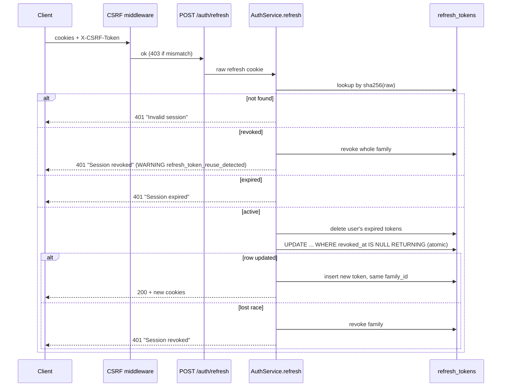

# Auth and Sessions

Last reviewed: 2026-10-10

## Overview
Cookie-based auth: short-lived JWT access token plus rotating opaque refresh token, CSRF double-submit. Details: [security](../architecture/security.md).

## Workflow
Register creates the user and immediately logs in (issues cookies). Login issues a new refresh-token family. Refresh rotates within the family. Logout revokes the presented token; logout-all and password change revoke every active token of the user.

## Components
`app/api/v1/routes/auth.py`, `app/api/cookies.py`, `app/services/auth_service.py`, `app/core/security.py`, `app/repositories/user_repository.py` (`revoke_refresh_token_if_active`), `app/core/middleware.py::CSRFMiddleware`, `app/core/rate_limit.py`.

## API contract
`POST /api/v1/auth/register|login|refresh|logout|logout-all` (see [api-overview](../api/api-overview.md)). Register/login/refresh return `AuthResponse{user}` and set `access_token`, `refresh_token` (httpOnly) and `csrf_token` cookies. Logout returns `{message}`. Login/register request bodies: `LoginRequest`, `RegisterRequest` (`schemas/auth.py`; the test suite asserts short passwords are rejected).

## Data model
`users`, `refresh_tokens(token_hash unique, family_id, revoked_at, expires_at, user_agent, ip_address)`.

## Failure scenarios
| Scenario | Status | Result |
|---|---|---|
| Duplicate email (incl. case) | 409 | handled; also concurrent register via savepoint + `IntegrityError` -> `ConflictError` |
| Wrong password / unknown email | 401 | handled; same message; dummy Argon2 verify |
| Disabled account | 401 | handled ("This account is disabled") |
| Refresh cookie missing | 401 | handled |
| Concurrent refresh with same token | one 200, others 401 and family revoked | handled (atomic UPDATE); concurrency test not found |
| DB down | 503 | handled by global handler |
| Argon2 CPU cost under load | - | unhandled (rate limits only) |

## Edge cases
Email is lower-cased/trimmed. Expired access cookie with valid refresh cookie: client must call refresh (CSRF header required). Logout with no/unknown cookie still clears cookies. Reuse detection can log out a legit user whose refresh response was lost (trade-off).

## Security
Hashed refresh tokens, family revocation, rate limits (register 5, login 10, refresh 30, logout-all 10 per minute), SameSite default `lax`. No email verification/password reset.

## Logging
INFO `user_registered`, `user_logged_in | user_id`, `password_changed`; WARNING `refresh_token_reuse_detected | user_id`. No emails/passwords/tokens.

## Testing
`backend/tests/api/test_auth.py` (registration, login errors, rotation, reuse revokes family, logout(-all), CSRF cases, password change revokes sessions, 429). No concurrency test found for refresh.

## Known limitations
Rate-limit key is `request.client.host`; per-instance memory store; register reveals existing emails.
