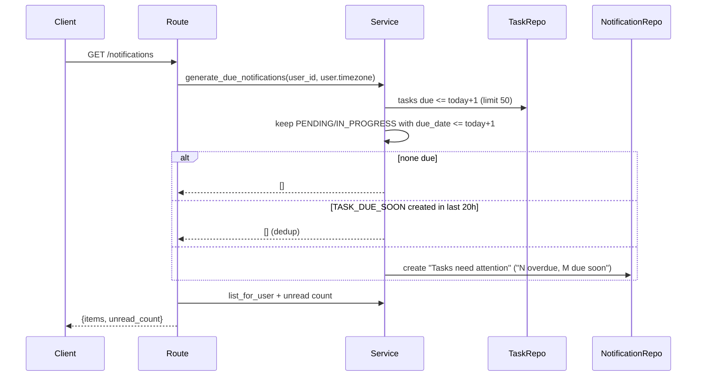

# Notifications

Last reviewed: 2026-10-10

## Overview
In-app notifications. Only one type is generated: `TASK_DUE_SOON`. Generation is **lazy**, on `GET /notifications` ([ADR-002](../decisions/ADR-002-lazy-notifications.md)).

## Workflow

## Components
`routes/notifications.py`, `services/notification_service.py`, `repositories/notification_repository.py`, `models/notification.py`, `schemas/search.py` (`NotificationResponse`, `NotificationListResponse`).

## API contract
`GET /notifications?unread_only&offset&limit(1..200, default 50)` -> `{items, unread_count}`; `POST /notifications/{id}/read` -> notification; `POST /notifications/read-all` -> `{"marked_read": n}`. CSRF applies to the POSTs.

## Data model
`notifications` (type, title, body, related_entity_type/id, is_read; index user+is_read).

## Failure scenarios
Foreign id -> 404 (handled). Generation failure makes the **read** endpoint fail (write on GET; unhandled by design). Two concurrent GETs can both pass the dedup check and create duplicates (race, unverified/untested).

## Edge cases
One aggregated notification per 20 h window regardless of task count; the `related_entity_id` is not set. Uses user timezone for "today". Tasks list capped at 50.

## Security
Owner-scoped; `user_id` from session.

## Logging
None.

## Testing
`backend/tests/api/test_search_notifications_privacy.py::test_notifications_due_tasks_and_read_flow` (single test; no dedup-window or timezone test found).

## Known limitations
`list_for_user` returns `(items, unread)`, unlike peer services' `(items, total)`. Not suitable for push/email delivery. `NotificationService` docs say a scheduler can call `generate_due_notifications` later; none exists.
