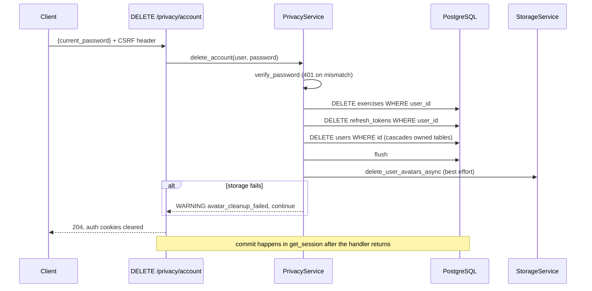

# Privacy: Export and Account Deletion

Last reviewed: 2026-10-10

## Overview
Full JSON export of owned data; permanent account deletion requiring the current password.

## Workflow

## Components
`routes/privacy.py`, `services/privacy_service.py`, `repositories/export_repository.py` (read queries), `api/cookies.py::clear_auth_cookies`, `services/storage_service.py`.

## API contract
`GET /api/v1/privacy/export` (10/min) -> JSON attachment `life-export.json` with `exported_at`, `profile` (no `hashed_password`), and arrays: tasks, habits, habit_logs, notes, health_metrics, custom_exercises, workouts, workout_sessions, learning_items, courses, learning_sessions, goals, notifications, tags, workout_sets, course_modules, course_lessons, goal_milestones. `DELETE /api/v1/privacy/account` (5/min) body `AccountDeleteRequest{current_password}` -> 204.

## Data model
Deletion relies on `ON DELETE CASCADE` from `users.id`; custom exercises are deleted explicitly (FK is SET NULL). Not exported: refresh tokens, note_directories, task_tags/note_tags (grep of `_owned_tables`/`_child_tables`; note_directories absent from the export).

## Failure scenarios
| Scenario | Result |
|---|---|
| Wrong password | 401 handled |
| Storage unavailable | partial: DB deleted, avatars may remain, WARNING logged |
| DB error mid-delete | rollback, 500/503 |
| Large accounts | export loads all rows in memory (unhandled) |

## Edge cases
Avatar purge happens before the request transaction commits; if the commit then failed, avatars would already be gone (ordering risk, inferred from code). Soft-deleted tasks/notes are included in export (queries filter only by `user_id`). The broad `except Exception` there is intentional and logged.

## Security
Password re-verification; rate limits; export strips credentials.

## Logging
WARNING `avatar_cleanup_failed | user_id | error` (redaction filter applied).

## Testing
`backend/tests/api/test_search_notifications_privacy.py::test_privacy_export_contains_all_owned_data`, `::test_privacy_delete_removes_account_and_data`. No purge-failure test.

## Known limitations
Notes folders missing from export; routes in OpenAPI share a combined tag.
