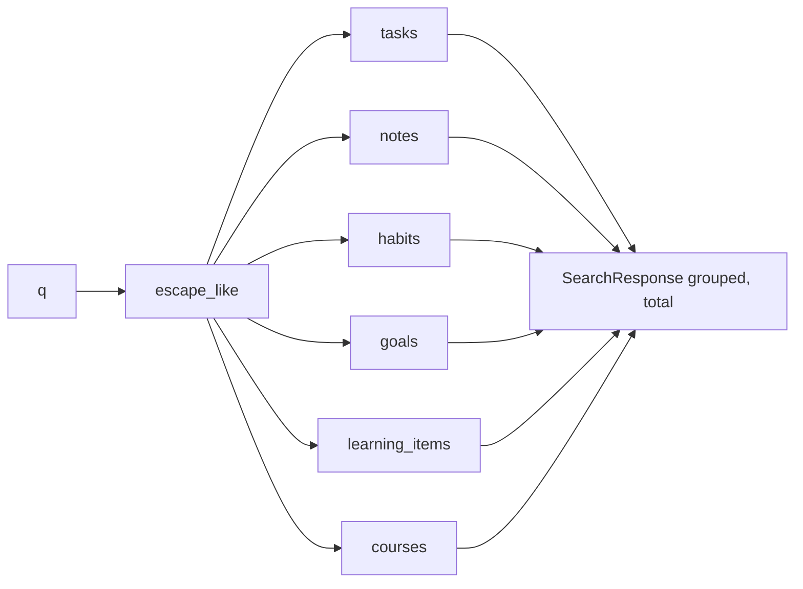

# Global Search

Last reviewed: 2026-10-10

## Overview
One endpoint searching tasks, notes, habits, goals, learning items, and courses for the current user.

## Workflow
`GET /search?q=` -> `SearchService.search`: trim, cap at 200 chars, `escape_like`, build `%pattern%`; run six sequential queries (limit 10 each); return groups only for non-empty types.

## Components
`routes/search.py`, `services/search_service.py`, `utils/sql.py::escape_like`, `schemas/search.py`.

## API contract
`GET /api/v1/search?q=<1..200 chars>` -> `{query, results: {tasks|notes|habits|goals|learning_items|courses: [{entity_type, id, title, snippet?}]}, total}`. Missing/empty/too-long `q` -> 422.

## Data model
No own tables. Reads the owned tables; excludes soft-deleted tasks/notes and recurring templates.

## Failure scenarios
DB error -> 503/500 via global handlers. Wildcard-only queries like `%` match literally (handled by escaping).

## Edge cases
Matching is case-insensitive ILIKE on title/description (tasks), title/content (notes), name (habits), title (others). Note snippet = first 200 chars of content; task snippet = description. Habits are matched regardless of `is_active`. `entity_type` values are inconsistent: singular `task`/`note` for those two, table name (e.g. `habits`) for others (from code).

## Security
Every query has `user_id == current user`; tested for no cross-user leakage.

## Logging
None.

## Testing
`backend/tests/api/test_search_notifications_privacy.py` (`test_global_search_finds_across_modules`, `test_search_does_not_leak_other_users_data`).

## Known limitations
The module docstring (`search_service.py:3-5`) claims Postgres full-text search for tasks/notes, but the code uses ILIKE; GIN tsvector indexes exist but are unused by this path (docs bug BE-040 still present). ILIKE `%x%` is a sequential scan; queries are sequential, not parallel.
