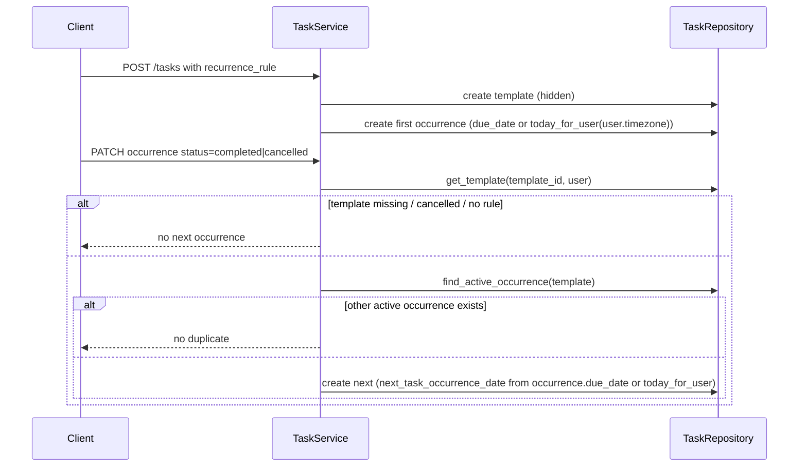

# Tasks and Recurrence

Last reviewed: 2026-10-10

## Overview
Tasks with priority, status, list (`today|upcoming|later`; API field `list`, ORM attribute `task_list`), due date/time, tags, soft delete, and template-based recurrence.

## Workflow: recurrence
A recurring task = one hidden **template** (`is_recurring_template=true`, holds `recurrence_rule` JSON) plus exactly one active **occurrence** (`recurrence_template_id` set). Completing or cancelling the occurrence generates the next one.

## Components
`routes/tasks.py`, `services/task_service.py`, `repositories/task_repository.py`, `utils/recurrence.py`, `utils/datetime.py::today_for_user`, `services/tag_service.py`, `schemas/task.py`.

## API contract
`GET /tasks` (Page; filters `status`, `list`, `due_before`, `due_on`, `due_from`, `search` (<=200), `overdue`, `priority`, `sort`, `order`), `POST /tasks`, `GET|PATCH|DELETE /tasks/{task_id}`, `PATCH /tasks/templates/{template_id}`. Title 1-200, description <=5000, duration 1..1440 min. `RecurrenceRule{frequency, weekdays[]}`; weekly requires weekdays when editing a template (422).

## Data model
`tasks` (see [data-architecture](../architecture/data-architecture.md)), `task_tags`.

## Failure scenarios
| Scenario | Result |
|---|---|
| Foreign/missing task | 404 handled |
| Weekly template without weekdays (update) | 422 handled; create path validation is in the schema (unverified) |
| Unknown tag ids | silently dropped (partial; no error) |
| Two concurrent completes of same occurrence | duplicate prevention relies on `find_active_occurrence` check, not a DB constraint (unhandled race, unverified) |

## Edge cases
Timezone: the user's timezone is passed by routes (`current_user.timezone`) to create/update/list; `today_for_user` replaces `date.today()` (BE-009 fixed in task_service; verified by grep: no `date.today()` in `task_service.py`). Invalid timezone names fall back to UTC (`utils/datetime.py`). Cancelling the template stops the series. Templates never appear in lists or search. `completed_at` set/cleared on status change.

## Security
All queries owner-scoped via `BaseRepository`; tags validated per owner.

## Logging
No task-specific logs.

## Testing
`backend/tests/api/test_tasks.py`, `backend/tests/unit/test_recurrence.py`. Non-UTC midnight recurrence tests: not confirmed.

## Known limitations
None specific. The `search` filter escapes wildcards (`task_repository.py:77-81`, verified).
