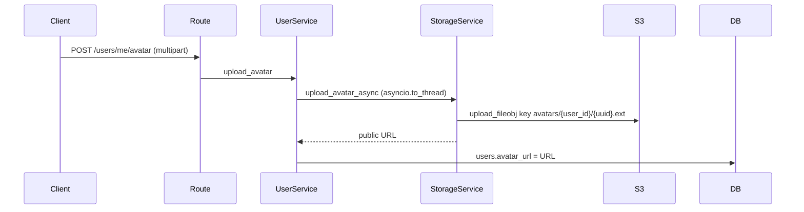

# Users, Sessions and Avatar Storage

Last reviewed: 2026-10-10

## Overview
Profile read/update, onboarding flag, password change, session list/revoke, avatar upload to S3-compatible storage.

## Workflow

## Components
`routes/users.py`, `services/user_service.py`, `services/onboarding_service.py`, `services/storage_service.py`, `repositories/user_repository.py`.

## API contract
`GET/PATCH /users/me`, `POST /users/me/avatar` (field `file`), `POST /users/me/onboarding`, `POST /users/me/password` (clears cookies), `GET /users/me/sessions`, `DELETE /users/me/sessions/{session_id}`. Schemas: `schemas/user.py`.

## Data model
`users` (email, hashed_password, full_name, avatar_url, timezone, theme_preference, notification_preferences JSON, is_active, email_verified_at, onboarding_completed_at); `refresh_tokens`.

## Failure scenarios
| Scenario | Result |
|---|---|
| Storage env not fully set | 503 `STORAGE_NOT_CONFIGURED` (handled) |
| Wrong content type / >2 MB | 422 `VALIDATION_ERROR` with `fields.file` (handled) |
| S3 error/timeout | logged ERROR, 502 `STORAGE_UPLOAD_FAILED` (handled); boto timeouts connect 5 s, read 10 s, 3 attempts |
| Another user's session id | 404 (handled) |
| Old avatar object not deleted on replace | partial: old objects remain until account deletion (no replace cleanup found) |
| Wrong current password | 401 (handled) |

## Edge cases
Content type comes from the client header, not content sniffing. Size measured by seeking the spooled file. Onboarding is idempotent. A storage object created before a later DB failure is orphaned (unverified).

## Security
Server-generated keys under per-user prefix; upload rate limit 10/min; password change 5/min and revokes all sessions.

## Logging
ERROR `avatar_upload_failed | user_id | error` (error text passes through the redaction filter).

## Testing
`backend/tests/api/test_users.py` (S3 stubbed). No real S3 failure tests (audit BE-025; not re-verified).

## Known limitations
`public_base_url` unset yields a bucket-relative path rather than a full URL. The route hosts some avatar logic (audit BE-018).
