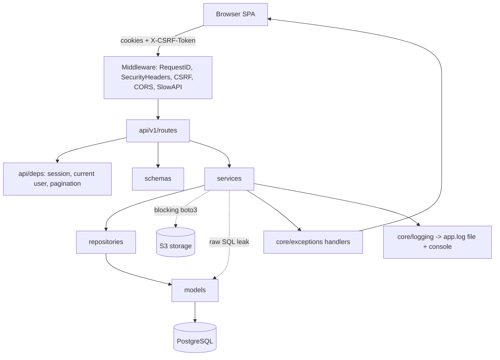
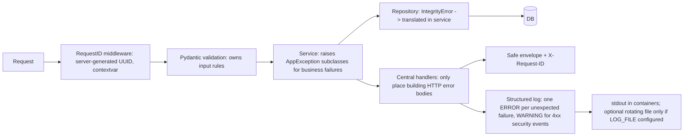

# Backend Audit Report

- **Date:** 2026-10-10 (last reviewed)
- **Scope:** `backend/` (FastAPI, SQLAlchemy 2 async, Alembic, PostgreSQL)
- **Method:** Four read-only specialist reviews (architecture, errors/logging, API/data/security, testing/docs) consolidated by the lead. No source, config, migration, or dependency was modified. **No tests, linters, or type checks were executed**; test/CI statements below come from code inspection only.
- **Confidence labels:** Confirmed = verified in code; Likely = strong code evidence, not reproduced; Unverified = hypothesis.
- **Status:** Awaiting approval. No remediation has been started.

---

## 1. Executive Summary

The backend is well structured for its size. Layering (routes -> services -> repositories -> models) is largely respected; ownership scoping is enforced inside repository queries (`repositories/base.py::_base_query`), giving strong IDOR protection with a 404-not-403 convention. Refresh tokens are hashed, rotated, and family-revoked on reuse. CSRF double-submit, security headers, a unified error envelope, and a safe 500 handler exist. All migrations have downgrades. Test isolation (per-test rollback, user-B isolation tests) is good. No Critical issues were found.

The material gaps are operational and hardening-related:

| Area | Assessment | Basis |
|---|---|---|
| Architecture | Sound layered monolith; minor leaks (raw SQL in 3 services, FastAPI import in a service, logic in 2 routes) | Sections 5, 6 |
| Exceptions | Good central design; gaps: pagination ValidationError -> 500, register race -> 500, no DB-timeout mapping | BE-004, BE-005 |
| Logging | Weakest area: relative-path file log (ephemeral in containers), DEBUG to disk, no request ID in log lines, import-time side effects, dead `LOG_LEVEL` setting | BE-001..BE-003 |
| Security | No critical flaws; races in refresh rotation, login timing, insecure `samesite` default, unescaped ILIKE | BE-006..BE-014 |
| Data integrity | Schema, constraints, indexes are good; check-then-insert races | BE-005, BE-007, BE-015 |
| Testing | ~125 tests, strong authz/CSRF; no concurrency, redaction, shutdown, or DB-down tests; CI has no coverage or security scan | BE-020..BE-025 |
| Documentation | Good architecture doc; no per-feature docs, API catalog, ERD, logging policy, runbook, ADRs; some factual errors | Section 9 |

**Highest-priority items:** BE-001 (log destination), BE-002/BE-003 (logging config + request-ID correlation), BE-004 (pagination 500), BE-005 (register race), BE-006 (refresh rotation race), BE-008 (blocking boto3), BE-009 (timezone bug in task recurrence), BE-020 (shutdown/engine dispose).

**Not verified:** runtime behavior behind a real proxy, actual baseline test/lint/mypy results, dependency vulnerability scan (`pip-audit` not run), `.env` contents (deliberately not read), frontend.

---

## 2. Technology Stack and Repository Structure

| Item | Finding (source) |
|---|---|
| Language | Python >=3.11 (`pyproject.toml`; AGENTS.md says venv is 3.11) |
| Framework | FastAPI 0.115.6, uvicorn 0.32.1 (`requirements.txt`, pinned `==`, no hash lockfile) |
| DB / ORM | PostgreSQL, SQLAlchemy 2.0.36 async, asyncpg 0.30, Alembic 1.14 |
| Validation | Pydantic 2.10.3, pydantic-settings 2.6.1 |
| Auth | PyJWT, argon2-cffi, httpOnly cookies + CSRF double-submit |
| Rate limit | slowapi 0.1.9, `memory://` storage (`config.py`, `render.yaml`) |
| Object storage | boto3 1.35.74 (S3 avatars, `storage_service.py`) |
| Cache / broker / jobs | **None.** No Celery, Redis, BackgroundTasks, schedulers (verified by grep) |
| Logging | stdlib `logging`, text format, `RotatingFileHandler("app.log")` |
| Lint/type | ruff (E,F,I,UP,B,SIM), mypy (lax: `disallow_untyped_defs=false`) |
| Tests | pytest + pytest-asyncio, real Postgres (`life_test`) |
| Deploy | `backend/Dockerfile` (non-root, migrate-on-boot), `render.yaml`, `docker-compose.yml` |
| CI | `.github/workflows/ci.yml`: ruff, mypy, pytest, frontend lint/type/unit/build |

```
backend/app
  main.py            app factory, middleware, handlers
  api/               deps.py, router.py, liveness.py, v1/routes/* (14 modules)
  core/              config, exceptions, logging, middleware, rate_limit, security
  db/                session.py, base.py
  models/            12 modules + mixins
  repositories/      base + 11 repos
  services/          20 services (+ progress_rules, authorization)
  schemas/           Pydantic contracts
  utils/             datetime, enums, pagination, recurrence, streaks
backend/migrations/versions   5 revisions
backend/tests         unit, integration, api
```

---

## 3. Inventories

### 3.1 Feature / endpoint inventory

| Feature | Endpoints (prefix `/api/v1`) | Service | Repository | Tables |
|---|---|---|---|---|
| Auth | POST auth/register, login, refresh, logout, logout-all | `auth_service` | `user_repository` | users, refresh_tokens |
| Users | GET/PATCH users/me; avatar; onboarding; password; sessions | `user_service`, `storage_service`, `onboarding_service` | `user_repository` | users, refresh_tokens |
| Tasks | CRUD tasks, templates | `task_service` | `task_repository` | tasks, task_tags |
| Habits | CRUD, log, history, streak | `habit_service` | `habit_repository` | habits, habit_logs |
| Goals | CRUD, milestones | `goal_service` | `goal_repository` | goals, goal_milestones |
| Learning | items, courses, modules, lessons, sessions | `learning_service` | `learning_repository` | learning_items, courses, course_modules, course_lessons, learning_sessions |
| Workouts | exercises, workouts, workout sessions/sets | `workout_service` | `workout_repository` | exercises, workouts, workout_sessions, workout_sets |
| Health metrics | GET/POST/DELETE health/metrics | `health_service` | `health_repository` | health_metrics |
| Notes | CRUD notes | `note_service` | `note_repository` | notes, note_tags |
| Note directories | CRUD, move | `note_directory_service` | `note_directory_repository` | note_directories |
| Tags | GET/POST tags | `tag_service` | `tag_repository` | tags |
| Search | GET search | `search_service` | (inline SQL) | notes, tasks, ... |
| Notifications | list, mark read (hosted in `routes/search.py`) | `notification_service` | `notification_repository` | notifications |
| Privacy | GET privacy/export, DELETE privacy/account (in `routes/search.py`) | `privacy_service` | (inline SQL) | all owned tables |
| Dashboard / Analytics / Calendar | GET summaries | `dashboard_service`, `analytics_service`, `calendar_service` | mixed (inline SQL) | read-only |
| Liveness | GET /health, /health/db (unversioned) | `api/liveness.py` | n/a | n/a |

Rate limits seen: register 5/min, login 10/min, refresh 30/min, logout-all 10/min, password 5/min, privacy export 10/min, delete 5/min. Page size capped at 100.

### 3.2 Database

Users own all data via `OwnedMixin.user_id` (FK CASCADE). Soft-delete (`deleted_at`) on tasks and notes. `exercises.user_id` is nullable (shared catalog). Unique: `lower(email)`, tags/note_directories `(user_id,name)`, `habit_logs(habit_id,log_date)`, refresh `token_hash`. CHECKs on health value >=0 and goal progress 0-100. `Numeric(10,2)` for metrics. Timestamps `timezone=True`. Migrations: `2d27dbcfe619` initial, `fe6451055195` pgcrypto, `53096170c4b1` FK/composite indexes, `9f4a2c1e7b3d` server-default fix, `c4a8d2e61b90` note directories (head). `life_test` can lag dev DB (AGENTS.md).

### 3.3 External integrations

Only S3-compatible storage (`storage_service.py`). No third-party HTTP APIs, queues, or caches.

### 3.4 Background processing

None. Notifications are generated lazily on read with a 20h dedup window (`notification_service.py`). Consequence: read endpoints perform writes; not scalable to cron-style delivery.

---

## 4. Current-State Architecture

Style: **layered modular monolith**, single process, single database.



Request lifecycle: middleware -> router -> dependency (`get_session`: one session per request, commit on success, rollback on error; `get_current_user` loads user per request) -> service -> repository -> response model. Errors: `AppException` subclasses / validation / HTTP / catch-all handlers produce `{"error":{"code","message","fields?"}}`.

Existing diagrams: none beyond ASCII/prose in `docs/ARCHITECTURE.md`. Missing: system context, ERD, request sequence, error/logging flow, feature sequences.

---

## 5. Code Quality and Architecture Findings

Positive: routes are thin; settings centralized in `core/config.py`; no circular imports; no `os.environ` scattered; ownership scoping is structural.

| ID | Finding | Evidence |
|---|---|---|
| BE-008 | Blocking boto3 called on event loop | `storage_service.py:55,92,113-117`; `routes/users.py:49` |
| BE-009 | `date.today()` in business logic violates documented timezone rule, causing off-by-one recurrence for non-UTC users | `task_service.py:53,171`; ARCHITECTURE.md:45 |
| BE-016 | Raw SQL inside services, duplicated between dashboard and analytics | `dashboard_service.py:124-146`, `analytics_service.py:119-144`, `privacy_service.py:64-140` |
| BE-017 | Service imports FastAPI `Response` | `auth_service.py:14,144-185` |
| BE-018 | Business logic in routes (avatar handling, delete-account password check) | `routes/users.py:44-52`, `routes/search.py:95-100` |
| BE-019 | Dead code: `require_owner`, `RateLimitedError`, `_ = TaskStatus`, commented `configure_logging()` | `authorization.py:19`, `exceptions.py:55`, `analytics_service.py:147`, `main.py:27` |
| BE-026 | Oversized functions (>50 lines): `export_user_data`, both `build_summary` | files above |
| BE-027 | Import-time side effects: engine, limiter, logging | `db/session.py:9-23`, `rate_limit.py`, `logging.py` |
| BE-028 | `routes/search.py` hosts search + notifications + privacy; `NotificationService.list_for_user` returns `(items, unread)` unlike peers `(items, total)` | files above |
| BE-029 | Magic strings for task status instead of enum | `notification_service.py:77`, `analytics_service.py:91` |
| BE-030 | Lax mypy (`disallow_untyped_defs=false`) | `pyproject.toml` |

---

## 6. Exception Handling and Logging Gap Analysis

### 6.1 Existing handling by layer

| Layer | Behavior | Verdict |
|---|---|---|
| Middleware | RequestID, CSRF returns envelope inline | OK; request ID unused in logs |
| Handlers (`core/exceptions.py`) | `AppException`, validation (422), Starlette HTTP, catch-all 500 with `exc_info` and request ID | Good |
| Routes | No try/except | Good |
| Services | `IntegrityError` -> `ConflictError` in savepoints (tags, directories); specific boto exceptions; one intentional broad catch in `privacy_service.py:159` (logged WARNING) | Good, with gaps |
| DB session | commit/rollback generator | Good |
| Background jobs | none | N/A |

No swallowed exceptions (`except: pass`) found. No duplicate logging (root handlers cleared, uvicorn handlers stripped).

### 6.2 Gaps

| ID | Sev | Conf | Gap | Evidence |
|---|---|---|---|---|
| BE-001 | High | Confirmed | File log uses relative path `app.log`; location depends on cwd (copies exist at repo root and `backend/`). In Docker/Render it lands on an ephemeral filesystem, invisible to log aggregation. Tests importing `app.main` also create it. | `core/logging.py:12-14`, `Dockerfile` WORKDIR, `render.yaml` |
| BE-002 | Medium | Confirmed | Logging configured at import time; `configure_logging()` is a commented-out stub. | `core/logging.py:35-46`, `main.py:27` |
| BE-003 | Medium | Confirmed | `settings.log_level` / `LOG_LEVEL` is never read; root and file handler hardcoded to DEBUG (production would write DEBUG to disk). | `config.py:69`, `render.yaml:41` |
| BE-031 | Medium | Confirmed | No request ID in log records (no contextvar/filter); only the 500 line carries it. | `middleware.py:39-42`, `exceptions.py:99` |
| BE-032 | Low | Likely | Client `X-Request-ID` trusted unvalidated: log-line forging via newlines. | `middleware.py:39` |
| BE-033 | Low | Confirmed | Plain-text format, not machine-readable. | `logging.py:4-6` |
| BE-034 | Low | Confirmed | Raw exception text logged; asyncpg/botocore messages may include hostnames/bucket names. No redaction filter and no redaction tests. | `liveness.py:46`, `storage_service.py:94,120` |
| BE-004 | Medium | Confirmed | `get_pagination` constructs `PaginationParams` manually; `page_size=0` or `>100` raises pydantic `ValidationError` (not `RequestValidationError`) -> generic 500. | `api/deps.py:29-30` |
| BE-005 | Medium | Confirmed | Register does check-then-insert; concurrent submit hits unique index -> 500 instead of 409. | `auth_service.py:42-44` |
| BE-035 | Low | Confirmed | No mapping for DB timeout/`OperationalError` (falls to 500; acceptable but undistinguished, no 503). | `exceptions.py` |
| BE-036 | Low | Confirmed | `StarletteHTTPException` flattened to `HTTP_ERROR`; noise log `logger.info("list of habits")`. | `exceptions.py:94`, `habit_service.py:37` |
| BE-037 | Low | Confirmed | `.dockerignore` does not exclude `*.log`; backend `.gitignore` lacks it (root `*.log` covers git). | `.dockerignore` |
| BE-038 | Low | Confirmed | `/health/db` has no probe timeout. | `liveness.py` |

Doc mismatches: ARCHITECTURE.md claims "Structlog JSON logs" (code is stdlib text), 429 code `RATE_LIMIT_EXCEEDED` (code: `RATE_LIMITED`), validation 400 (code: 422), `app/repos/` (actual `app/repositories/`).

### 6.3 Proposed target-state design



Policy:
- **Validation:** schemas/`Query(...)` constraints; services enforce business rules.
- **Exceptions:** services raise `AppException` subclasses; repositories/infrastructure errors translated at service boundary (`IntegrityError` -> `ConflictError`); a global `IntegrityError`/`OperationalError` handler as a safety net (409 / 503).
- **HTTP responses:** only in `core/exceptions.py` and middleware.
- **Logging once:** log unexpected exceptions only in the catch-all handler; expected 4xx at INFO/WARNING without stack traces.
- **Correlation:** contextvar set in `RequestIDMiddleware`, injected by a logging filter; incoming ID accepted only if matching `^[A-Za-z0-9-]{8,64}$`, else regenerated.
- **Redaction:** filter masking password/token/cookie/authorization/DSN patterns; never log bodies.
- **Format:** JSON in production (stdlib `logging` with a small JSON formatter; no new dependency needed), text in dev.
- **Destination:** stdout/stderr by default (Render/Docker collect it). File logging only when `LOG_FILE` is set to an absolute path inside an approved directory (e.g. `<repo>/logs/` in dev, gitignored and dockerignored), with rotation 5 MB x 5. Level from `LOG_LEVEL` (INFO in prod).
- **Retries:** none today; only idempotent S3 operations may be retried (bounded, with timeouts). Non-idempotent writes are never retried.
- **Startup/shutdown:** `validate_production_secrets` fails fast (exists); add FastAPI `lifespan` that disposes the engine. Extend secret validation to staging.
- **Jobs:** none exist; if added, they need their own failure log with job ID and idempotency key.

---

## 7. Security and Data Integrity Findings

Verified clean: IDOR on nested resources (modules, lessons, milestones, tags, exercises, directories, sessions), soft-delete respected in reads, account deletion requires password and purges avatars/exercises, export strips password hash, avatar keys are server-generated (no path traversal), no N+1 observed, all list endpoints bounded, migrations reversible.

| ID | Sev | Conf | Finding | Evidence | Fix | Verify |
|---|---|---|---|---|---|---|
| BE-006 | Medium | Likely | Refresh rotation not atomic; two concurrent refreshes both succeed, defeating reuse detection | `auth_service.py:73-103` | Conditional `UPDATE ... WHERE revoked_at IS NULL RETURNING`; rowcount 0 = reuse | Concurrency test with `asyncio.gather` |
| BE-007 | Low | Likely | Habit log upsert race | `habit_repository.py:37-45` | `ON CONFLICT DO UPDATE` | Concurrent PUT test |
| BE-010 | Medium | Likely | Rate limit keyed on `request.client.host`; behind proxy all users share one bucket; `memory://` not shared across instances | `rate_limit.py:16`, `render.yaml:40` | Trusted-proxy config (`--proxy-headers --forwarded-allow-ips`) + Redis storage when scaling | Test with forwarded header |
| BE-011 | Low | Confirmed | Login timing differs for unknown emails; registration 409 enumerates | `auth_service.py:52-56` | Dummy Argon2 verify; accept 409 trade-off | Timing test (loose) |
| BE-012 | Low | Confirmed | `cookie_samesite` default `"none"` (`.env.example` uses lax) | `config.py:53` | Default `lax` | Config unit test |
| BE-013 | Low | Confirmed | ILIKE wildcards unescaped | `search_service.py:31`, `task_repository.py:76` | Escape `%`, `_`, `\` | Search test with `%` |
| BE-014 | Low | Confirmed | Weak-secret validation only in production | `config.py:98-105` | Apply to non-dev/test | Unit test |
| BE-015 | Low | Likely | No global request-body size cap | n/a | Content-Length middleware / ingress cap | Oversized-body test |
| BE-039 | Low | Confirmed | Avatar upload has no rate limit; `/analytics/calendar` range unbounded; streak endpoint lacks response model | `users.py:38-52`, `habits.py:132-141` | Add limit, cap range, add schema | API tests |
| BE-040 | Low | Confirmed | Search docstring claims full-text search; code is ILIKE (seq scan at scale) | `search_service.py:4,56` | Fix docstring now; `pg_trgm` index if data grows | Query plan under load (unmeasured) |

No critical vulnerabilities were identified. A dependency vulnerability scan was not run.

---

## 8. Testing, Reliability, Performance

### 8.1 Coverage by feature (inspection only; tests not executed)

| Feature | Tests | Failure paths | AuthZ isolation | Concurrency |
|---|---|---|---|---|
| Auth | 19 | strong | n/a | none |
| Users/sessions | 8 | some | partial | none |
| Onboarding | 1 | none | none | none |
| Tasks | 12+ | yes | yes | none |
| Habits | 12+ | yes | yes | none |
| Goals | 3 | none | yes | none |
| Learning | 4 | none | yes | none |
| Workouts | 5 | yes | yes | none |
| Health | 3 | yes | yes | none |
| Notes / directories / tags | 6 / 11 / 7 | yes | yes | none |
| Search | 2 | none | yes | none |
| Analytics / calendar / dashboard | 4 / 4 | yes | yes | none |
| Notifications | 1 | none | none | none |
| Privacy | 2 | no purge-failure path | none | none |
| Storage | 2 (S3 stubbed) | no S3 failure | none | none |
| Liveness | 2 | no DB-down 503 | n/a | none |
| Migrations | 3 | yes | n/a | none |

### 8.2 Findings

| ID | Sev | Conf | Finding | Evidence |
|---|---|---|---|---|
| BE-020 | Medium | Confirmed | No lifespan/shutdown; engine never disposed | `main.py`, `db/session.py:11` |
| BE-021 | Medium | Confirmed | CI lacks coverage threshold, security scan, container build | `ci.yml` |
| BE-022 | Medium | Confirmed | No concurrency tests (refresh, habit upsert, register) | tests |
| BE-023 | Medium | Likely | No log-redaction tests; DEBUG file | `logging.py` |
| BE-024 | Medium | Confirmed | Notifications (lazy generation, dedup) minimally tested; read endpoint performs writes | `notification_service.py:56-103` |
| BE-025 | Low | Confirmed | No `/health/db` 503 test; no S3 failure tests | tests |
| BE-041 | Low | Confirmed | Pool: no `pool_recycle`/`pool_timeout` | `db/session.py:11-17` |
| BE-042 | Low | Confirmed | Dockerfile keeps `build-essential` in runtime image; no hashed lockfile for transitive deps | `Dockerfile:11-16` |
| BE-043 | Low | Confirmed | Sequential awaits in search/dashboard (6 queries); analytics per-habit-per-day loop, unmeasured | `search_service.py:34-40`, `analytics_service.py:53-72` |

Performance claims are estimates from code reading; nothing was measured. No background workers means no worker-reliability concerns today.

---

## 9. Documentation Coverage

Existing: `README.md`, `AGENTS.md`, `docs/ARCHITECTURE.md`, `DEPLOYMENT.md`, `BACKUP_RESTORE.md`, `TESTING.md`, `engineering-checklist.md`, `feature-enhancements.md`, `codebase-changes.md`, `codebase-engineering-review.md`, `reviews/*` (point-in-time).

| Feature | API doc | Workflow | Diagram | Data model | Errors/edge | Security | Testing | Decisions |
|---|---|---|---|---|---|---|---|---|
| Auth/sessions | Missing | Partial (ARCHITECTURE) | Missing | Missing | Partial | Partial | Partial (TESTING.md) | Missing |
| Users/storage | Missing | Missing (README says S3 "planned": stale) | Missing | Missing | Missing | Missing | Missing | Missing |
| Tasks/recurrence | Missing | Docstrings only | Missing | Missing | Missing | N/A | Missing | Missing |
| Habits/streaks | Missing | Docstrings only | Missing | Missing | Missing | N/A | Missing | Missing |
| Goals | Missing | Missing | Missing | Missing | Missing | N/A | Missing | Missing |
| Learning | Missing | Missing | Missing | Missing | Missing | N/A | Missing | Missing |
| Workouts | Missing | Missing | Missing | Missing | Missing | N/A | Missing | Missing |
| Health metrics | Missing | Missing | Missing | Missing | Missing | N/A | Missing | Missing |
| Notes/directories/tags | Missing | Partial (AGENTS.md) | Missing | Partial (AGENTS.md) | Missing | N/A | Missing | Missing |
| Search | Missing | Missing | Missing | N/A | Missing | N/A | Missing | Missing |
| Analytics/dashboard/calendar | Missing | Partial (formulas) | Missing | N/A | Missing | N/A | Missing | Missing |
| Notifications | Missing | Complete-ish (ARCHITECTURE:92) | Missing | Missing | Missing | N/A | Missing | Partial |
| Privacy | Missing | Partial | Missing | Missing | Missing | Partial | Missing | Missing |
| Cross-cutting: logging, errors, ERD, runbook, ADRs | Missing | | | | | | | |

Diagrams existing: none (Mermaid). Required: system context, container, component, request sequence, ERD, error/logging flow, plus feature sequences for auth refresh, task recurrence, privacy delete. Background-job diagram: not applicable (no jobs).

### Proposed `docs/` structure (to create after approval)

```
docs/
  README.md                       index + freshness table
  architecture/ system-overview.md, current-state.md, module-dependencies.md,
                data-architecture.md (ERD), error-handling.md,
                logging-and-observability.md, security.md,
                deployment-and-configuration.md
  features/    auth.md users-and-storage.md tasks.md habits.md goals.md
               learning.md workouts.md health-metrics.md notes.md
               search.md analytics-dashboard-calendar.md notifications.md privacy.md
  api/         api-overview.md error-responses.md
  database/    schema-overview.md migrations.md
  testing/     testing-strategy.md   (merge existing TESTING.md)
  operations/  troubleshooting.md runbook.md
  decisions/   ADR-001-logging-destination.md ADR-002-lazy-notifications.md ...
```
Existing ARCHITECTURE.md, DEPLOYMENT.md, TESTING.md should be corrected/relocated, not duplicated. Each feature doc follows the 17-section template from the audit brief, grounded in real paths.

---

## 10. Consolidated Issue Register

Type key: D=confirmed defect, G=missing functionality, T=technical debt, O=optional improvement.

| ID | Cat | Sev | Type | Module / symbol | Missing or incorrect | Conf |
|---|---|---|---|---|---|---|
| BE-001 | Logging | High | D | `core/logging.py` | Relative-path file log, ephemeral in containers | Confirmed |
| BE-008 | Code | High | D | `storage_service.py` | Blocking boto3 on event loop | Confirmed |
| BE-009 | Code | High | D | `task_service.py:53,171` | `date.today()` ignores user timezone | Confirmed |
| BE-002 | Logging | Medium | T | `core/logging.py`, `main.py` | Import-time config, dead stub | Confirmed |
| BE-003 | Logging | Medium | D | `config.py:69` | `LOG_LEVEL` ignored; DEBUG to disk | Confirmed |
| BE-031 | Logging | Medium | G | middleware/logging | No request ID in logs | Confirmed |
| BE-004 | Errors | Medium | D | `api/deps.py:29-30` | Pagination bounds -> 500 | Confirmed |
| BE-005 | Data | Medium | D | `auth_service.py:42-44` | Register race -> 500 | Confirmed |
| BE-006 | Security | Medium | D | `auth_service.py:73-103` | Non-atomic refresh rotation | Likely |
| BE-010 | Security | Medium | G | `rate_limit.py` | Proxy IP handling; per-instance store | Likely |
| BE-016 | Arch | Medium | T | dashboard/analytics/privacy services | SQL outside repositories, duplicated | Confirmed |
| BE-017 | Arch | Medium | T | `auth_service.py` | Service depends on FastAPI | Confirmed |
| BE-018 | Arch | Medium | T | `routes/users.py`, `routes/search.py` | Logic in routes | Confirmed |
| BE-020 | Reliability | Medium | G | `main.py` | No lifespan / engine dispose | Confirmed |
| BE-021 | Testing | Medium | G | `ci.yml` | No coverage or security scan | Confirmed |
| BE-022 | Testing | Medium | G | tests | No concurrency tests | Confirmed |
| BE-023 | Testing | Medium | G | tests | No redaction tests | Likely |
| BE-024 | Testing | Medium | G | notifications | Thin tests; GET writes | Confirmed |
| BE-040 | Docs/Perf | Medium | D | `search_service.py` | Docstring claims FTS; ILIKE only | Confirmed |
| BE-007, 011-015, 019, 025-030, 032-039, 041-043 | various | Low | T/O | see sections 5-8 | see sections 5-8 | mixed |
| BE-044 | Docs | Medium | D | `docs/ARCHITECTURE.md`, `README.md` | Factual errors (structlog, codes, paths, S3 "planned"); no feature docs, ERD, API catalog, runbook, ADRs | Confirmed |

Full evidence, fix, and verification per ID are in sections 5-8 tables. Dependencies: BE-031 depends on BE-002; BE-003 on BE-002; BE-023 on BE-002/BE-034; BE-022 validates BE-006/007/005; BE-044 follows all behavior changes.

---

## 11. Remediation Roadmap

Priority P1 highest. Sizes: S/M/L. All tasks update docs listed in Phase 6.

**Phase 0 - Baseline (sequential, first).** T0.1 run `ruff`, `mypy app`, `pytest`, `pip-audit` and record results (S). T0.2 decide logging policy (stdout default; optional `LOG_FILE`) and ADR (needs owner input). T0.3 confirm BE-006/BE-010 with failing tests.

**Phase 1 - Correctness/security.**
- T1.1 (BE-009, P1, M) thread user timezone into `task_service`; replace `date.today()` with `today_for_user`. Tests: recurrence in non-UTC zones near midnight. Rollback: revert commit.
- T1.2 (BE-006, P1, M) atomic refresh revocation. Tests: concurrent refresh yields one success + family revoke.
- T1.3 (BE-005, BE-007, P1, S) savepoint + `ConflictError` on register; `ON CONFLICT` for habit log.
- T1.4 (BE-004, P1, S) `Query(ge/le)` in `get_pagination`; test 422 for `page_size=0`.
- T1.5 (BE-008, P1, M) `asyncio.to_thread` around boto3, add S3 client timeouts; tests with stubbed failures.
Parallel: T1.1, T1.2/T1.3 (different files), T1.4, T1.5.

**Phase 2 - Errors and logging (sequential within phase).**
T2.1 (BE-002/003) `configure_logging(settings)` from `create_app`, honor `LOG_LEVEL`. T2.2 (BE-001) stdout default, optional `LOG_FILE` absolute path, rotation, gitignore/dockerignore `logs/` and `*.log`. T2.3 (BE-031/032) contextvar request ID + sanitize inbound header. T2.4 (BE-033/034) JSON formatter in prod + redaction filter. T2.5 (BE-035/036) global `IntegrityError` and `OperationalError` handlers, remove noise log. T2.6 (BE-020) lifespan engine dispose. Tests: redaction, request ID in records, no file created by default, level honored.

**Phase 3 - Architecture and standards (parallel after Phase 2).**
T3.1 (BE-016) move SQL to repositories, dedupe. T3.2 (BE-017/018) move cookie helper and route logic. T3.3 (BE-019/029) dead code, enums. T3.4 (BE-028) split `routes/search.py` (keep URLs unchanged). T3.5 (BE-026/030) split long functions; enable `disallow_untyped_defs` incrementally per module.

**Phase 4 - API/data hardening (parallel).** BE-010 proxy config, BE-011..015, BE-039, BE-041 pool settings, BE-012/014 config defaults.

**Phase 5 - Testing.** BE-021 coverage threshold (set from measured baseline) + `pip-audit`; BE-022 concurrency tests; BE-024/025 notification, health-DB-down, S3 failure tests.

**Phase 6 - Documentation.** Create structure from section 9; fix BE-044 errors; Mermaid diagrams (section 12); freshness table. Feature docs can be written in parallel, one per feature.

**Phase 7 - Performance.** Measure first; then consider `gather` in dashboard/search and `pg_trgm` for search only if measurements justify (BE-040/043). Decide on moving notification generation to a scheduler only with product input.

**Phase 8 - Verification.** Full ruff/mypy/pytest on `life_test` migrated to head (see AGENTS.md note about both DBs), manual check of log destinations, doc-vs-code review.

---

## 12. Required Diagrams (to be added in Phase 6)

Existing: none. Missing: A system context, B deployment (Render web service + Postgres + S3), C component (section 4 as starting point), D request lifecycle, E feature sequences (auth refresh, recurrence, privacy delete), F ERD (from section 3.2), G error/logging flow (section 6.3), I current vs target. H not applicable.

---

## 13. Coding Rules and Quality Gates

| Rule | Why | Enforced today | Missing | Compliance test |
|---|---|---|---|---|
| ruff format+lint | consistency | Lint in CI; no `ruff format --check` | add format check | CI |
| Type safety | catch contract bugs | mypy lax | gradual `disallow_untyped_defs` | mypy in CI |
| SQL only in repositories | single ownership, dedupe | convention | review; optionally import-linter | grep/arch test |
| Services do not import FastAPI | transport independence | convention | arch test | import test |
| No `date.today()`/`datetime.now()` naive in services | timezone correctness | doc only | ruff `DTZ` rules | lint |
| Raise `AppException` subclasses; no broad except unless logged+commented | consistent errors | partial | ruff `BLE`/`S110` | lint |
| Log once, structured, no secrets | observability | none | filter + tests | redaction tests |
| Request params validated via `Query`/schemas | avoid 500s | partial | fix BE-004 | API tests |
| Every new route has ownership + failure-path tests | IDOR/regressions | convention | PR checklist | tests |
| Coverage threshold | regression | none | pytest-cov gate from baseline | CI |
| Dependency/security scan | supply chain | none | pip-audit (and optionally bandit) | CI |
| Migrations reversible and tested | safety | yes (`test_migrations.py`) | none | existing |
| Docs updated with behavior change | accuracy | checklist | PR template | review |

---

## 14. Validation Strategy and Open Questions

Validation: execute Phase 0 baseline before any change; each remediation task adds a failing test first; run full suite against migrated `life` and `life_test`; verify no `app.log` is created under default config; verify docs against code in Phase 8.

Open questions needing owner input:
1. Is persistent file logging wanted anywhere (dev only, or never)? Proposed default: stdout only.
2. Will production run multiple instances (drives Redis rate limiting and notification scheduling)?
3. Is a trusted reverse proxy used on Render (drives client-IP handling)?
4. Acceptable to enumerate emails on register (409), or is email verification planned?
5. Should `routes/search.py` be split now (URL-neutral) or deferred?
6. Coverage target: propose setting it just below the measured baseline.

Constraints: audit was inspection-only; findings marked Likely (BE-006, 007, 010, 015, 023, 032) require the listed tests to confirm. Prior reports in `docs/reviews/` were not re-validated and may be stale.
